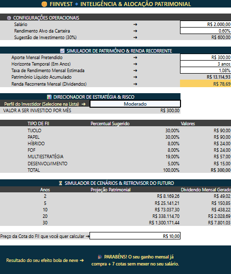
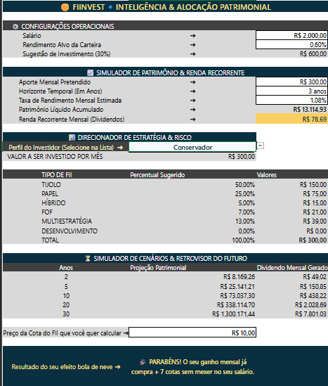
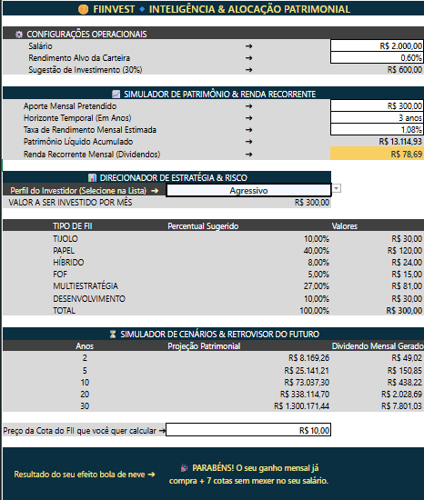
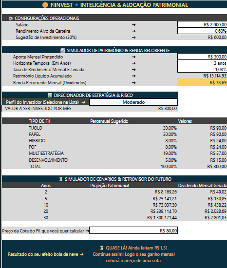

<h1 align="center"> 🪙 FIINVEST🔹INTELIGÊNCIA & ALOCAÇÃO PATRIMONIAL com Excel </h1>
</div>
<p align="center">
  
<p align="center">
<div align="center">

> <p align="center"> Este desafio faz parte do Bootcamp **Santander - Excel com IA e Claude** desenvolvido em parceria com a plataforma da [DIO].
> <p align="center">O projeto consiste no desenvolvimento do **FIINVEST**, um aplicativo de tela limpa voltado à simulação de juros compostos, análise de cenários multidimensionais e distribuição automatizada de capital no mercado de Fundos Imobiliários (FIIs), desenhado sob a perspectiva *beyond-tech* e de minimalismo estrutural.
</div>

## 🧬 Estrutura do Repositório | Índice Prático

```text
🗂 Desafio_01-Criando_uma_Ferramenta_de_Controle_de_Investimentos_com_Excel
|
├── 🗂️ entregaveis/             # Capturas de tela do sistema operando (Formatos PNG/JPG)
├── 🧪 Simulador_FII_KatAk.xlsx # Arquivo executável da planilha (Gabarito prático de backoffice)
└── 📝 README.md                # Bastidores analíticos, documentação lógica e governança
```
---

## 📟 Resumo do Enunciado

**Desafio:** Construir do zero uma ferramenta de simulação patrimonial focada em Fundos Imobiliários, conectando de forma fluida aportes mensais, horizontes temporais e perfis de risco.<br>
**Escopo Principal:** Desenvolver uma interface integrada com "cara de aplicativo" que automatize cálculos matemáticos complexos e divida o capital de forma inteligente entre os principais segmentos imobiliários. <br>
**Funcionalidades Centrais:**
*   Módulo de simulação de patrimônio a médio prazo e geração de renda passiva.<br>
*   Módulo de projeção em cascata para cenários temporais de 2 a 30 anos.<br>
*   Sistema de alocação tática por perfil de risco integrado a chaves lógicas compostas.<br>
*   Uso rigoroso de intervalos nomeados para eliminar coordenadas abstratas e simplificar a auditoria.<br>
**Resultado Esperado:** Uma solução corporativa segura e intuitiva, onde qualquer profissional ou investidor consiga ler cenários e tomar decisões sem necessidade de digitar ou compreender fórmulas.<br>

---

## ☑️ Cumprimento dos Requisitos do Desafio | Checklist

Abaixo está o mapeamento de conformidade com as metas obrigatórias e evoluções implementadas:

[✓] **Interface Premium "FIINVEST":** Ocultação de linhas de grade, cabeçalhos de linha/coluna e barra de fórmulas. Aplicação da paleta corporativa em Azul Petróleo Profundo (HEX `#0A2F41`) nos banners de fundo, utilizando o emoji de moeda (`🪙`) como âncora funcional e fonte em **Dourado Champagne (HEX `#FAE284`) em negrito** para contraste de alto padrão com a tipografia *Segoe UI*.<br>
[✓] **Mapeamento de Linhas e Ergonomia:** Inclusão de linhas de respiro estruturais (linhas 2, 7, 14, 18 e 27) para delimitar as seções e evitar a sobrecarga cognitiva do usuário final.<br>
[✓] **Cálculo de Patrimônio Líquido:** Integração da função financeira `VF` para prever o montante acumulado e cálculo indexado de dividendos mensais.<br>
[✓] **Projeção de Cenários em Escala:** Estruturação da matriz temporal estendida do ano 2 ao ano 30 (linha 34), utilizando travamentos com referências absolutas (`$`).<br>
[✓] **Configurações & Governança de Dados:** Implementação da diretriz de investimento de 30% do salário e substituição completa de coordenadas por Intervalos Nomeados.<br>
[✓] **Divisão Automatizada por Perfil:** Criação de validação de dados por lista suspensa na célula `perfil_escolhido`, integrada ao motor de busca por chave combinada.<br>

---

## 🔣 Engenharia de Fórmulas e Processos por Trás do Sistema

### 1. Matriz Dinâmica de Risco via Chave Composta (`PROCV`)<br>

Para fatiar o capital automaticamente na tabela de alocação de ativos (linhas 20 a 25) com base na escolha do investidor:<br>
- **Fórmula de Alocação (Célula B20):** `=PROCV(perfil_escolhido & "-" & A20; apoio!$A:$D; 4; FALSO)`<br>
- **Fórmula de Distribuição Monetária (Célula C20):** `=B20 * valor_investido`<br>
- **Fórmula do Totalizador de Aportes (Célula C26):** `=SOMA(C$20:C$25)`<br>

**Explicação Non-Tech:** O Excel concatena o perfil selecionado (`Célula B16`) e o nome do ativo (`Célula A20`), gerando uma identificação única (ex: `Moderado-TIJOLO`). O comando `PROCV` localiza esse código na aba de `apoio`, extrai a taxa percentual e a multiplica pelo capital travado em `valor_investido` (Célula B17). O fechamento exato do aporte de R$ 300,00 é auditado e consolidado pela soma segura na linha 26.<br>

### 2. Projeção Temporal de Longo Prazo (`VF`)<br>

Para estimar a evolução patrimonial ao longo das décadas no Simulador de Cenários (linhas 30 a 34):<br>
- **Fórmula de Projeção (Célula B30):** `=VF(taxa_mensal; A$30*12; aporte*-1)`<br>
- **Fórmula de Renda Passiva (Célula C30):** `=B$30 * rendimento_carteira`<br>

**Explicação Non-Tech:** A função financeira calcula o crescimento dos juros compostos multiplicando os anos da coluna A por 12 meses, aplicando o intervalo nomeado `taxa_mensal` e o `aporte` original fixado. O ciclo se encerra na linha 34, projetando o cenário de 30 anos com precisão absoluta.<br>

---

## ♻️ Estratégia de Alocação (Refinamento da Grade de Ativos)<br>

A matriz de distribuição de ativos foi estruturada de forma a equilibrar a segurança patrimonial e a flexibilidade de mercado, aplicando critérios claros de simplificação:<br>

- **Consolidação de Ativos:** Os segmentos foram integrados diretamente nas categorias principais de imóveis físicos, evitando pulverizações e otimizando a leitura visual para o usuário.<br>
- **Inclusão de Multiestratégia:** Adicionou-se a classe de Fundos Multiestratégia, conferindo ao simulador uma camada de alocação mais flexível, dinâmica e resiliente para os cenários de médio e longo prazo.<br>
<br>

| Tipo de FII | Perfil Conservador | Perfil Moderado | Perfil Agressivo |
| :--- | :---: | :---: | :---: |
| **TIJOLO** (Imóveis Físicos) | 50% | 30% | 10% |
| **PAPEL** (Certificados/Crédito) | 25% | 30% | 40% |
| **HÍBRIDO** (Misto) | 5% | 8% | 8% |
| **FOF** (Fundo de Fundos) | 7% | 8% | 5% |
| **MULTIESTRATÉGIA** (Flexível) | 13% | 19% | 27% |
| **DESENVOLVIMENTO** (Projetos) | 0% | 5% | 10% |
| **TOTAL VERIFICADO** | **100%** | **100%** | **100%** |

---

## ♾️ Inteligência de Negócio: Indicador "Bola de Neve" [Autossuficiência Patrimonial]<br>

Foi implementado um cálculo tático que demonstra o **Ponto de Virada Financeira** (Linhas 36 e 38). <br>
Afastando-se de jargões matemáticos complexos, o sistema conta com um módulo de tradução de cenários desenhado sob uma abordagem humanizada e de gamificação (UX), transformando dados brutos em feedbacks emocionais e preditivos em tempo real:<br>
- **Texto de Entrada (Célula A36):** `Preço da Cota do FII que você quer calcular ➔`<br>
- **Texto de Resultado (Célula A38):** `Resultado do seu efeito bola de neve ➔`<br>
- **Fórmula Lógica do Visor (Célula B38):** ``` excel
  =SE(C13>=B36; "🎉 PARABÉNS! O seu ganho mensal já compra + " & INT(C13/B36) & " cotas sem mexer no seu salário."; "⏳ QUASE LÁ! Ainda faltam R$ " & ARRED(B36-C13;2) & ". Continue assim! Logo o seu ganho mensal cobrirá o preço de uma cota.")```<br>
- **Abordagem de Usabilidade & UX:** O investidor informa o preço atual da cota (`Célula B36`, indicada pelo rótulo na `Célula A36`)  e o sistema calcula se a renda recorrente acumulada (`Célula C13`) já ultrapassa o custo de uma cota (`Célula B36`), atingindo a autossuficiência.<br>
*Em caso de sucesso:* Celebra a conquista com a insígnia de comemoração festiva (`🎉`).<br>
*Caso o montante seja menor:* O motor lógico realiza uma subtração contábil automática e renderiza a expressão de impacto positivo "QUASE LÁ! Continue assim!" (`⏳`), apontando o valor residual exato e arredondado (`ARRED`) que separa o investidor do ponto de virada, estimulando a regularidade financeira de forma acolhedora.`<br>
- **Resultado Prático:** Demonstra visualmente que a regularidade e os reinvestimentos geram autossuficiência de forma exponencial, garantindo que o patrimônio cresça sozinho,  sem a necessidade de novos desembolsos do salário.<br>

---

## 🏷️ Inventário de Intervalos Nomeados Criados<br>

As variáveis centrais foram batizadas na Caixa de Nome do Excel, forçando o "Preto Puro" (RGB 0,0,0) nos valores claros para contraste de alta nitidez e ativando a **Formatação Condicional Cromática** (na célula de resposta `B38` acende em Dourado Champagne para o sucesso e em Laranja Bronze para o processo em maturação):<br>
- `aporte` ➔ Vinculado ao valor investido no fundo imobiliário (Célula `C9`).<br>
- `tempo_anos` ➔ Vinculado ao prazo selecionado, aplicando a máscara personalizada `0" anos"` (Célula `C10`).<br>
- `taxa_mensal` ➔ Vinculado à taxa de rendimento estimada para a simulação (Célula `C11`).<br>
- `rendimento_carteira` ➔ Vinculado à taxa padrão histórica de dividendos (Célula `C5`).<br>
- `perfil_escolhido` ➔ Vinculado ao seletor de risco com formato de botão executivo azul suave (Célula `B16`).<br>
- `valor_investido` ➔ Célula automatizada de espelhamento do capital para a tabela de FIIs (Célula `B16`), protegida contra alterações para mitigar inconsistências operacionais.<br>
- Célula `B36` ➔ Variável aberta para inserção livre do preço do ativo estudado pelo investidor.<br>
- Célula `C13` **(Destaque de Ouro)** ➔ Célula de dividendos configurada com preenchimento **Dourado Suave (RGB `250,207,97`)**, protegida e travada como o principal indicador de valor do negócio.<br>

---

## 🛡️ Proteção & Governança de Processos<br>

O sistema foi estruturado sob uma **política de segurança multicamadas**:<br>

1. **Aba APP:** Configuração de intervalos editáveis rígidos, mantendo apenas as 7 células de entrada desbloqueadas para digitação e interação do usuário, enquanto o motor de cálculo (fórmulas e visores) foi completamente congelado contra edições.<br>
2. **Aba apoio:** Configurada sob congelamento total (100% protegida), blindando a retaguarda, as tabelas de referência e as chaves compostas contra manipulações indevidas.<br>
3. **Auditabilidade:** O recurso opera sem senhas restritivas de abertura, assegurando que avaliadores e recrutadores possam auditar a engenharia das fórmulas de forma transparente.<br>

---

## 📦 Entregáveis Visuais do Aplicativo Operando (Roteiro de Testes)<br>

Abaixo estão as capturas de tela que validam o comportamento dinâmico do motor de cálculo, a alteração tática de ativos por perfil de risco e a inteligência emocional do sistema:<br>

### 🟡 Teste 1: Perfil Moderado (Gabarito Base)<br>
**Configuração:** Aporte de R$ 300,00 e Preço da Cota parametrizado em R$ 10,00.<br>
**Entregável:** Demonstra a distribuição equilibrada do capital nas colunas B e C e o acionamento do indicador comemorativo.<br>



### ⚪ Teste 2: Transição para Perfil Conservador (Mudança de Alocação)<br>
**Configuração:** Alteração no seletor `perfil_escolhido` para "Conservador".<br>
**Entregável:** Valida o motor do `PROCV` migrando automaticamente 50% do capital para fundos de TIJOLO e reduzindo a exposição em segmentos de maior risco.<br>
  

<br>
### 🟠 Teste 3: Transição para Perfil Agressivo (Foco em Performance)<br>
**Configuração:** Alteração no seletor para "Agressivo".<br>
**Entregável:** Valida a reestruturação da grade em tempo real, concentrando 40% do aporte no segmento de PAPEL.<br>
  

<br>
### ⏳ Teste 4: Cenário de Maturação (Indicador Preditivo Ativado)<br>
**Configuração:** Perfil Moderado com Preço da Cota alterado para R$ 80,00 na célula `B36`.<br>
**Entregável:** Valida a formatação condicional alternando a fonte para Laranja Bronze e calculando o valor exato residual que falta para atingir a autossuficiência.<br>
  

<br>
---

🏆 Conclusão | Melhorias & Próximos Passos
---

O **FIINVEST** consolidou a entrega de um simulador patrimonial moderno, eliminando coordenadas abstratas por meio de Intervalos Nomeados e blindando dados com proteção multicamadas. O grande diferencial foi o design focado na experiência do usuário (UX), que traduziu jargões técnicos em um painel interativo, amigável e gamificado na linha 38 para guiar investidores leigos de forma acolhedora.

Como visão de futuro e melhorias contínuas utilizando recursos 100% gratuitos e nativos do Excel, o projeto possui o seguinte backlog de expansão:
*   **Automação (Power Query):** Conectar a aba de retaguarda diretamente a tabelas públicas da internet para atualizar preços e dividendos dos FIIs de forma automática.
*   **Módulo de Rebalanceamento:** Criar fórmulas contábeis que cruzam o patrimônio atual com as metas do perfil, indicando quais ativos precisam ser comprados para equilibrar a carteira.
*   **Gráficos Dinâmicos:** Inserir um gráfico de rosca minimalista integrado à tabela de alocação de FIIs que se reestrutura visualmente acompanhando a formatação condicional cromática.

**Com a implementação destas diretrizes, a ferramenta cumpre integralmente os requisitos de governança do Bootcamp, entregando uma solução estável, escalável e de alto valor prático para o gerenciamento de ativos de retaguarda.**

---
## 🗺️ Conexões do Ecossistema<br>

🔗 **Projeto Full:** [Acessar Pasta do Desafio](https://github.com)<br>
🗃️ **HUB Principal:** [Retornar ao Portfólio de Projetos](https://github.com)<br>
🆔 **Perfil Profissional:** [Visualizar Identidade GitHub](https://github.com)<br>
🌌 **Presença Digital:** [Conectar via LinkedIn & Ecossistema Visual](https://github.com)
